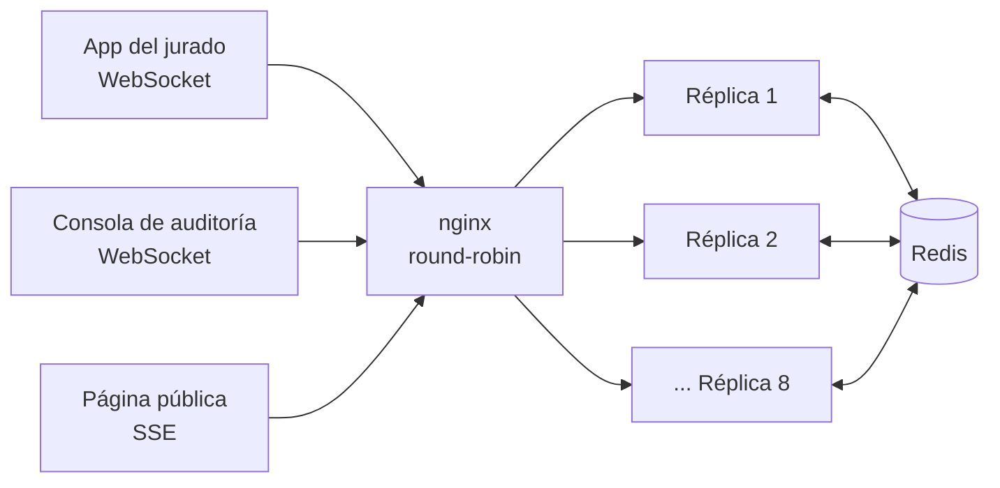

# Preconteo electoral en tiempo real

Taller final de Programación Orientada: sistema de **preconteo de votos en tiempo real** para una
jornada electoral departamental.

- **Jurados** envían las actas (formulario E14) de **6.400 mesas** por **WebSocket**.
- **Público** ve los resultados acumulados en vivo por **Server-Sent Events (SSE)**.
- **Auditores** revisan las actas que no cuadran, con bloqueo exclusivo y presencia en vivo.

Corre en **8 instancias de Node.js (Fastify)** detrás de **nginx en round-robin, sin sesiones
pegajosas**. Las instancias se coordinan **solo a través de Redis** (scripts Lua, Pub/Sub y
Streams).

> El código está en inglés. Esta guía y los documentos de `docs/` están en español.

---

## 1. Probarlo ya, sin instalar nada (demo en línea)

> ✅ **La URL correcta de la aplicación es https://websocketsvotaciones-frontend.vercel.app**
> (cualquier otra dirección de Vercel que aparezca en el historial es una prueba anterior).

| Aplicación             | URL                                                                 |
| ---------------------- | ------------------------------------------------------------------- |
| Portada                | https://websocketsvotaciones-frontend.vercel.app/                   |
| Resultados públicos    | https://websocketsvotaciones-frontend.vercel.app/public/?topic=dept |
| App del jurado         | https://websocketsvotaciones-frontend.vercel.app/juror/             |
| Consola de auditoría   | https://websocketsvotaciones-frontend.vercel.app/auditor/           |
| Backend (API, Railway) | https://api-production-19233.up.railway.app/health                  |

Los frontends están en **Vercel** y el backend + Redis en **Railway** (una instancia). Las 8
réplicas se demuestran en local con Docker (sección 2).

**Demostración sugerida (5 minutos):**

1. Abra **Resultados públicos** en una pestaña. Debe aparecer el indicador **"live"**.
2. Abra la **App del jurado** en otra pestaña, entre con un ID (ej. `JUR-1001`) y envíe un acta.
   En la pestaña pública el acumulado se actualiza al instante, sin recargar.
3. Envíe un acta cuyos votos **no sumen** el total de sufragantes: queda como **dudosa** y no
   suma al acumulado.
4. Abra la **Consola de auditoría** en dos pestañas con IDs distintos (`AUD-1` y `AUD-2`).
   Cada una ve a la otra en "presencia" y la cola de actas dudosas. Si ambas toman un caso,
   **reciben actas distintas** (bloqueo distribuido).
5. En la app del jurado, desconecte la red (modo avión o DevTools → Offline) y envíe un acta:
   queda guardada en el equipo y **se envía sola al volver la conexión**.

---

## 2. Correrlo en local con las 8 réplicas (recomendado para revisar)

**Requisitos:** [Docker Desktop](https://www.docker.com/products/docker-desktop/) y
[Node.js 22](https://nodejs.org/) (Node solo hace falta para tests y scripts).

```bash
git clone https://github.com/St-Alejo/Websockets_votaciones.git
cd Websockets_votaciones
npm install
npm run compose:up
```

Eso levanta **Redis + carga del catálogo + 8 réplicas de la app + nginx** en
**http://localhost:8080**. Cuando termine (≈1 minuto la primera vez), abra:

| Aplicación            | URL local                                |
| --------------------- | ---------------------------------------- |
| Portada               | http://localhost:8080/                   |
| Resultados públicos   | http://localhost:8080/public/?topic=dept |
| App del jurado        | http://localhost:8080/juror/             |
| Consola de auditoría  | http://localhost:8080/auditor/           |
| Estado de una réplica | http://localhost:8080/health             |
| Métricas              | http://localhost:8080/metrics            |

Para apagar todo: `npm run compose:down`.

> **¿Puerto 8080 ocupado?** Use otro:
> PowerShell: `$env:NGINX_PORT=8081; npm run compose:up` — Bash: `NGINX_PORT=8081 npm run compose:up`.
> Luego cambie `8080` por `8081` en las URLs.

### Llenar el sistema con una jornada completa simulada

Con el compose arriba, este comando envía **7.109 actas** (nuevas, reenvíos, correcciones fuera
de orden y dudosas) a través de nginx, y al final verifica que el acumulado sea exactamente el
esperado:

```bash
docker compose -f infra/docker-compose.yml exec --index 1 -e MODE=http -e URL=http://nginx -e REDIS_URL=redis://redis:6379 -e CLEAN=1 app node scripts/simulate-tallies.js
```

Salida esperada (resumen):

```text
By instance: {"e2ae...":889,"f8de...":889, ... 8 réplicas ...}
Department totals CONSISTENT with expected (5950 tables reported).
Verification queue: 450 doubtful tallies pending.
```

Después abra la página pública: verá ~93 % de mesas informadas, y la consola de auditoría tendrá
450 actas por revisar.

---

## 3. Cómo verificar cada requisito

| Requisito                                   | Cómo comprobarlo                                                                                                                                                                                        |
| ------------------------------------------- | ------------------------------------------------------------------------------------------------------------------------------------------------------------------------------------------------------- |
| 8 réplicas sin sesión pegajosa              | Ejecute varias veces `curl http://localhost:8080/instance`: el `instance` cambia en cada petición (round-robin).                                                                                        |
| Idempotencia (un reenvío no suma dos veces) | Envíe la misma acta dos veces (mismo `idem`): la segunda responde `duplicate` con el mismo `receipt`.                                                                                                   |
| Correcciones y desorden                     | Una `version` mayor reemplaza a la anterior; una menor que llegue tarde responde `stale_version`. El acumulado siempre converge.                                                                        |
| Actas dudosas                               | Si la suma de votos ≠ `voters`, responde `doubtful`, no suma y entra a la cola de verificación.                                                                                                         |
| Tiempo real entre réplicas                  | El público conectado a la réplica A recibe el acta que el jurado envió a la réplica B (Redis Pub/Sub).                                                                                                  |
| Reconexión sin perder eventos               | El SSE envía `id:` en cada evento; al reconectar, el navegador manda `Last-Event-ID` y se reenvía lo perdido desde el Redis Stream.                                                                     |
| Contrapresión (clientes lentos)             | Un cliente que no consume se suspende y recibe un snapshot al recuperarse; si sigue saturado, se desconecta (`tests/realtime/rf9-*`).                                                                   |
| Bloqueo de auditores                        | Dos auditores que piden caso reciben actas distintas; el bloqueo expira si el auditor deja de enviar latidos.                                                                                           |
| Presencia distribuida                       | Cada auditor ve a los demás aunque estén en otra réplica; desaparecen al desconectarse.                                                                                                                 |
| Límite de tasa por jurado                   | Más de 20 actas por minuto del mismo jurado → HTTP **429** con `Retry-After`.                                                                                                                           |
| Redis caído                                 | `docker compose -f infra/docker-compose.yml stop redis` → `POST /tallies` responde **503** explícito al instante y `/health` = `degraded`. Con `start redis` se recupera solo y los datos siguen (AOF). |
| App del jurado sin conexión                 | Las actas quedan en IndexedDB y se reenvían al reconectar, sin duplicarse.                                                                                                                              |

### Tests automáticos

```bash
npm run redis:dev                                    # Redis local en el puerto 6379
npm test                                             # ~120 tests (vitest) contra Redis real
npm run lint                                         # ESLint
```

En PowerShell, si los tests de Redis aparecen como _skipped_: `$env:REDIS_URL="redis://localhost:6379"; npm test`.

---

## 4. Arquitectura



**Recorrido de un acta:**

1. El jurado envía el acta por WebSocket (`/ws/juror`) o HTTP (`POST /tallies`) y cae en
   cualquier réplica.
2. La réplica la valida y ejecuta **un único script Lua** en Redis
   (`src/redis/scripts/register.lua`). En una operación atómica hace todo esto:
   - revisa la idempotencia y la versión;
   - actualiza los acumulados de mesa, puesto, municipio y departamento, y los rankings;
   - si el acta no cuadra, la manda a la cola de verificación;
   - la guarda en el **Stream** (historial) y la publica en el canal **Pub/Sub** `tally:new`.
3. **Todas** las réplicas reciben el evento por Pub/Sub y lo reenvían, agrupado por tópico, a
   sus clientes SSE suscritos (`dept`, `mun:11`, `station:5`, `table:9`).
4. El jurado recibe su confirmación (`registered`, `duplicate`, `doubtful`...) con un recibo.

| Pieza de Redis                | Para qué se usa                                                         |
| ----------------------------- | ----------------------------------------------------------------------- |
| Scripts Lua                   | Registro atómico de actas, snapshot consistente, límite de tasa         |
| HASH `total:*`, ZSET `rank:*` | Acumulados y rankings por nivel                                         |
| STREAM `stream:tallies`       | Historial para reanudar clientes que se reconectan                      |
| Pub/Sub                       | Difusión entre las 8 réplicas (`tally:new`, `verification`, `presence`) |
| ZSET `queue:verification`     | Cola de actas dudosas ordenada por gravedad del descuadre               |
| `lock:tally:*` con TTL        | Bloqueo exclusivo de un caso por auditor                                |
| `presence:*` con TTL          | Presencia de auditores                                                  |
| `idem:*` con TTL 24 h         | Idempotencia de reenvíos                                                |

---

## 5. API (resumen)

| Método y ruta                  | Descripción                                                                                                                   |
| ------------------------------ | ----------------------------------------------------------------------------------------------------------------------------- |
| `POST /tallies`                | Registra un acta. 201 `registered`, 200 `duplicate`/`stale_version`, 202 `doubtful`, 409 `conflict`, 400 `rejected`, 429, 503 |
| `GET /totals/:level/:id?`      | Acumulado de `dept`, `mun/11`, `station/5` o `table/9`                                                                        |
| `GET /ranking/:level/:id?`     | Candidatos ordenados por votos                                                                                                |
| `GET /sse/public?topic=dept`   | Resultados en vivo (SSE): evento `snapshot` y luego `delta`                                                                   |
| `WS /ws/juror?juror=JUR-1`     | Envío de actas con confirmación                                                                                               |
| `WS /ws/auditor?auditor=AUD-1` | Cola, toma de casos, latidos y presencia                                                                                      |
| `GET /health`, `GET /instance` | Estado de la réplica y de su conexión a Redis                                                                                 |
| `GET /metrics`                 | Métricas: conexiones, mensajes/s, lag del event loop, memoria                                                                 |

Ejemplo de acta (el total de votos debe ser igual a `voters`):

```bash
curl -X POST http://localhost:8080/tallies -H "content-type: application/json" -d '{
  "tally": "E14-176-4201-03", "table": 4201, "station": 176, "municipality": 11,
  "version": 1, "juror": "JUR-88134", "closed_at": 1793577600,
  "votes": { "C1": 184, "C2": 97, "C3": 311, "BLANK": 22, "NULL": 9, "UNMARKED": 4 },
  "voters": 627, "photo_hash": "9f2c", "idem": "8f14e45fceea167a"
}'
```

El contrato completo está en [`docs/contratos.md`](docs/contratos.md).

---

## 6. Estructura del código

```text
src/
  server.js, config.js        buildApp(): Fastify + Redis + carga automática de src/plugins
  contracts/                  claves de Redis, canales, esquemas (zod), formato del stream
  domain/                     validación, catálogo de mesas, errores, fachada del dominio
  redis/                      cliente, registro de actas, acumulados, historial, scripts Lua
  fanout/  transport/         difusión por tópicos, SSE, contrapresión, reconexión
  metrics/                    métricas y lag del event loop
  verification/  presence/    cola de verificación, bloqueos, latidos, presencia
  plugins/
    core/                     /tallies, /totals, /ranking, /health, /instance
    realtime/                 /sse/public, /metrics
    verification/             /ws/juror, /ws/auditor
frontend/
  public/  juror/  auditor/   las tres aplicaciones (HTML + JS sin build)
  config.js                   URL del backend (mismo origen en local, Railway en Vercel)
scripts/                      seed-catalog, simulate-tallies, fake-juror, fake-emitter
infra/                        Dockerfile, docker-compose (8 réplicas), nginx.conf
test/  tests/                 tests de humo y de tiempo real
docs/                         informe técnico de cada integrante y contratos
```

### Comandos útiles

| Comando                       | Qué hace                                                   |
| ----------------------------- | ---------------------------------------------------------- |
| `npm run compose:up` / `down` | Entorno completo: Redis + 8 réplicas + nginx               |
| `npm run redis:dev`           | Solo Redis (para desarrollo y tests)                       |
| `npm run dev`                 | Una instancia en http://localhost:3000 con recarga         |
| `npm test` / `npm run lint`   | Tests y linter                                             |
| `npm run fake:juror`          | Envía actas de prueba (reenvíos, correcciones y dudosas)   |
| `npm run fake:emitter`        | Publica un evento de acta por segundo (para probar el SSE) |

---

## 7. Equipo y documentación

| Integrante | Responsabilidad                                                    | Informe                                                          |
| ---------- | ------------------------------------------------------------------ | ---------------------------------------------------------------- |
| Persona 1  | Infraestructura, Redis, registro idempotente, acumulados           | [`docs/persona1-redis.md`](docs/persona1-redis.md)               |
| Persona 2  | Difusión en tiempo real (SSE), contrapresión, reconexión, métricas | [`docs/persona2-fanout.md`](docs/persona2-fanout.md)             |
| Persona 3  | Verificación, bloqueos, presencia, WebSockets y frontends          | [`docs/persona3-verificacion.md`](docs/persona3-verificacion.md) |

Los informes de `docs/` explican las decisiones de diseño con mediciones. Fueron escritos antes
de pasar el código a inglés, así que algunos nombres de archivos y funciones citados aparecen en
español.
